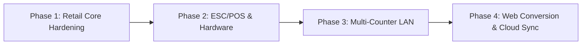

# Vertexia Retail POS — Complete System Architecture & Technical Audit

**Audit Date:** November 22, 2026  
**Auditor:** Senior Software Architect, POS Systems Engineer & Database Architect  
**Project:** Vertexia Retail POS (Desktop & Retail Management System)  
**Target Market:** Pakistani Retailers (Kiryana Stores, Mini Marts, Supermarkets, General Stores, Grocery Shops)  
**Deliverable Status:** Final Verified Technical Audit (No Code Modified)

---

## 1. Executive Summary

Vertexia Retail POS is an Electron-based desktop retail management and point-of-sale system engineered with **React 19**, **TypeScript 6**, **Vite 8**, **Tailwind CSS 4**, and an embedded **Node.js 22 built-in SQLite engine (`node:sqlite`)**.

Our exhaustive inspection of the codebase, 10 database migrations (41 `STRICT` relational tables), 50+ IPC channels, and 193 automated database tests (192 passing, 1 Windows OS privilege test skipped) reveals a system with an **exceptionally solid transactional core** for single-terminal operations. The underlying architecture avoids "toy POS" patterns: it uses integer paisa arithmetic, weighted-average inventory valuation, ACID transactions with `BEGIN IMMEDIATE`, document sequence numbering, double-entry general ledger posting, PBKDF2 credential hashing, and SHA-256 backup verification.

However, the application is currently bound to a **single-terminal desktop topology**. It cannot currently operate across multiple checkout counters simultaneously because cash shifts, document sequences, and IPC channels are scoped exclusively to the local Electron main process.

### Can We Evolve This Codebase Without Rebuilding Everything?
**Yes, absolutely.** The project was built with a clean separation of concerns:
1. The **React 19 frontend contains zero native Node.js or SQLite imports**. All data access is mediated through a typed bridge interface (`window.vertexia`).
2. The **backend business logic in `electron/database/` is decoupled from the UI rendering layer**, operating through typed request/response contracts (`database.mts`, `retail.mts`, `auth.mts`, `reports.mts`, `transfers.mts`).
3. To transform this desktop POS into a multi-counter LAN and web-accessible retail system, **no UI rewrite or database replacement is needed**. Evolution requires introducing an internal HTTP/WebSocket service layer (Fastify or native Node HTTP) on the Master terminal, transitioning single-tenant locks to multi-terminal tokens, and implementing an offline reconciliation protocol.

---

## 2. Complete Technology Stack

| Layer | Technology | Version | Purpose & Location in Codebase |
| :--- | :--- | :--- | :--- |
| **Frontend Framework** | React | `19.2.8` | Component rendering, UI state, hooks (`src/`) |
| **DOM Renderer** | React DOM | `19.2.8` | Virtual DOM hydration (`src/main.tsx`) |
| **Build Tool & Bundler** | Vite | `8.3.0` | Development HMR and frontend bundling (`vite.config.ts`) |
| **Styling Engine** | Tailwind CSS | `4.3.3` | Utility-first styling via `@tailwindcss/vite` (`src/index.css`) |
| **Motion & Animation** | Framer Motion | `14.0.0` | Cart transitions, drawer animations, UI feedback |
| **Barcode Rendering** | JSBarcode | `3.12.3` | Code128 / EAN barcode rendering on labels & receipts |
| **Image Processing** | PNGjs | `7.0.0` | ESC/POS bitmap preparation and label printing |
| **Desktop Runtime** | Electron | `44.7.0` | Chromium shell + Node.js runtime (`electron/main.mts`) |
| **Database Engine** | `node:sqlite` (`DatabaseSync`) | Node v22 Built-in | Embedded zero-dependency SQL engine (`electron/database/schema.mts`) |
| **Language & Typings** | TypeScript | `6.0.2` | End-to-end static typing across frontend and backend |
| **Linter** | Oxlint | `1.81.0` | High-performance Rust-based linter (`.oxlintrc.json`) |
| **Testing Harness** | Node.js Test Runner | Node v22 (`node --test`)| 15 automated database test suites in `tests/*.database.test.mjs` |

### Dependencies Summary
- **Zero Heavy Runtime ORMs:** No Prisma, TypeORM, or Sequelize overhead. All SQL queries use prepared statements with strict parameter binding.
- **Node.js Native Modules:** Relies on Node 22 native `node:sqlite`, `node:crypto`, `node:fs`, eliminating native compilation (`node-gyp`) fragility on client machines.

---

## 3. Existing Project Architecture

### 3.1 Folder Structure
```text
vertexia-retail-pos/
├── electron/                   # Electron Main Process & Native Backend
│   ├── backup.mts              # Database backup service, SHA-256 digests, restore locks
│   ├── database/               # Database domain logic & SQL migrations
│   │   ├── accounts.mts        # Chart of accounts & general ledger postings
│   │   ├── auth.mts            # PBKDF2 authentication, staff permissions, session management
│   │   ├── branches.mts        # Multi-branch CRUD & geographic metadata
│   │   ├── cash.mts            # Cash drawer shifts, pay-in/pay-out transactions
│   │   ├── database.mts        # Core POS sales, cart pricing, document numbering, held sales
│   │   ├── posting.mts         # Transactional wrapping & idempotency controls
│   │   ├── reports.mts         # Financial summaries, sales analytics, stock valuation
│   │   ├── retail.mts          # Supplier purchasing, inventory adjustments, accounts payable
│   │   ├── schema.mts          # 10 DDL migrations, 41 STRICT tables, PRAGMA setup
│   │   ├── transfers.mts       # Inter-branch inventory dispatch & receipt
│   │   └── valuation.mts       # Weighted-average cost calculation engine
│   ├── ipc-policy.mts          # RBAC enforcement, scope verification, operation idempotency
│   ├── licensing/              # License validation, offline leases, agency server
│   ├── main.mts                # Electron application lifecycle, IPC handler registration
│   ├── preload.cts             # Context isolation bridge (`window.vertexia`, `window.desktopApp`)
│   └── tsconfig.json           # Backend TypeScript build configuration
├── src/                        # React 19 Frontend Application
│   ├── app/                    # Routing, view switching, application shell
│   ├── domain/                 # Frontend business logic & repository contracts
│   ├── features/               # 17 domain-driven feature modules
│   │   ├── account/            # Staff profile, credentials, password reset
│   │   ├── branches/           # Multi-branch management view
│   │   ├── cash-shifts/        # Drawer reconciliation, opening/closing cash UI
│   │   ├── customers/          # Customer directory, Udhaar ledger, payment collection
│   │   ├── dashboard/          # Executive KPIs, revenue graphs, top-selling items
│   │   ├── expenses/           # Operational expense tracking & category breakdown
│   │   ├── inventory/          # Stock levels, movements, low-stock warnings, adjustments
│   │   ├── licensing/          # Commercial license activation modal & notices
│   │   ├── pos/                # Primary billing screen, cart, barcode scanner, tender modal
│   │   ├── products/           # Product catalog, SKU/barcode management, CSV import/export
│   │   ├── purchases/          # Supplier stock-inward, purchase orders, bill payment
│   │   ├── reports/            # Sales analytics, profit & loss, tax/margin exports
│   │   ├── sales/              # Historical invoice viewer, receipt reprint, sale returns
│   │   ├── settings/           # System preferences, store details, database path info
│   │   ├── staff/              # Employee directory, roles, granular permission assignment
│   │   ├── suppliers/          # Vendor management, purchase ledgers
│   │   └── transfers/          # Branch-to-branch inventory transfer tracking
│   ├── services/               # Licensing and cloud sync abstractions
│   ├── shared/                 # Shared UI components, icons, zoom controller, layouts
│   └── types/                  # Typed IPC contracts (`desktop-api.ts`, `auth.ts`)
├── tests/                      # 15 automated test suites for all backend domains
└── scripts/                    # Build, smoke test, and agency deployment automation
```

### 3.2 Frontend-Backend Communication
- **Architecture:** Electron Context Isolation with IPC (`contextBridge.exposeInMainWorld`).
- **Surface:** `window.vertexia` (operational business API) and `window.desktopApp` (window framing/zoom controls).
- **Security:** `ipc-policy.mts` validates user session permissions, branch ownership, and idempotency hash before executing any SQL statement. Direct SQLite access from React is strictly impossible.

---

## 4. Complete Feature Inventory and Implementation Status

Each feature is evaluated according to actual code verification:

| Module | Feature | Implementation Status | Technical Reality in Code |
| :--- | :--- | :--- | :--- |
| **POS Billing** | Fast Barcode Scanning | **Fully implemented** | Scanned input resolves instantly via indexed barcode query (`idx_products_barcode`). |
| | Product Search & Category Filter | **Fully implemented** | In-memory or indexed search filtering by name, SKU, and category. |
| | Cart Line Management | **Fully implemented** | Quantity increment/decrement with milli-unit precision (`quantity_milli`). |
| | Discounting (Percent & Fixed) | **Fully implemented** | Basis-point calculations (`discountBasisPoints`) validated by `pos.discount` permission. |
| | Single Payment Methods | **Fully implemented** | Supports `Cash`, `Card`, `JazzCash`, `Easypaisa`, `Udhaar`. |
| | **Split Payments** | **Not implemented** | `PosCompleteSaleRequest.paymentMethod` is a single string. Schema cannot store split tenders on one invoice. |
| | **Negative Stock Sale** | **Blocked / Rigid** | Line 440 of `database.mts` checks `quantity_milli >= line.quantityMilli`. Throws error if stock is 0. |
| | Hold & Resume Sales | **Fully implemented** | Carts serialize to `held_sales.cart_json` and restore atomically without stock deduction. |
| | Quick Product / Customer Creation | **Fully implemented** | Modals on POS screen call `pos.createProduct` and `pos.createCustomer` inline. |
| **Inventory** | Stock Level Tracking | **Fully implemented** | Tracked in `stock_levels` table per branch in integer milli-units (1 kg = 1000 milli). |
| | Stock Movements Audit | **Fully implemented** | Every sale, purchase, adjustment, and transfer logs an immutable row in `stock_movements`. |
| | Weighted Average Costing | **Fully implemented** | `stock_values` computes moving average unit cost on purchase inward (`valuation.mts`). |
| | Stock Adjustments | **Fully implemented** | Supports Damage, Expiry, Theft, Physical Count corrections with audit logging. |
| | Low Stock & Expiry Alerts | **Partially implemented** | Low stock calculation works (`minimum_stock_milli`); batch-specific expiry dates are not yet tracked per item. |
| **Purchasing** | Supplier Inward (GRN) | **Fully implemented** | `retail:receive-purchase` creates purchase records, updates stock levels, and logs supplier ledger. |
| | Duplicate Invoice Detection | **Fully implemented** | Tenant-wide case-insensitive check prevents duplicate supplier bill entries. |
| | Supplier Payments | **Fully implemented** | FIFO allocation against unpaid purchase bills with partial payment support. |
| **Udhaar & Ledgers**| Customer Credit Tracking | **Fully implemented** | Debits customer ledger on credit sale; rejects walk-in customers for Udhaar. |
| | Customer Debt Collection | **Fully implemented** | `customers:collect` creates numbered receipts (`REC-2026-XXXX`) and deposits to drawer. |
| | Customer Statements & History | **Fully implemented** | Running balances calculated across pagination without timestamp collisions. |
| **Cash & Shifts** | Shift Opening & Closing | **Fully implemented** | Cashiers declare opening balance and reconcile drawer at close. |
| | Cash In / Cash Out Movements | **Fully implemented** | `cash:move` records non-sale cash drawer adjustments. |
| | **Multi-Counter Shift Isolation** | **Not implemented** | `cash_shifts` is branch-scoped. Only 1 cashier shift can be open per branch at a time. |
| **Printing** | Receipt Printing | **Partially implemented** | Uses Chromium `window.print()` and CSS print stylesheets. |
| | **Direct ESC/POS Thermal Printing** | **Not implemented** | No raw USB/Serial byte streaming, no hardware drawer kick pulse, no Urdu bitmap rendering. |
| **Multi-Branch** | Inter-Branch Transfers | **Fully implemented** | `stock_transfers` supports Dispatch, Receive, and Cancel with transit tracking. |
| | Multi-Branch Switching | **Fully implemented** | Session branch selection updates visibility and posting scopes dynamically. |
| **Security & Auth** | Staff Roles & Permissions | **Fully implemented** | 18 granular permissions (`pos.sell`, `cash.manage`, `reports.read`, etc.). |
| | PBKDF2 Password Hashing | **Fully implemented** | Salted cryptographic hashes with brute-force lockouts and session expiration. |
| **Backup & Safety** | SQLite Online Backup | **Fully implemented** | `BackupService` uses `node:sqlite` `.backup()`, creates SHA-256 digests, and tests integrity. |

---

## 5. Database Schema and Storage Analysis

### 5.1 SQLite Configuration & Durability
- **Engine:** Built-in `node:sqlite` (`DatabaseSync`).
- **Concurrency Mode:** WAL (`PRAGMA journal_mode = WAL`).
- **Durability Mode:** Synchronous set to `FULL` during migration execution and `NORMAL` for high-throughput runtime.
- **Foreign Keys:** Strictly enforced (`PRAGMA foreign_keys = ON`).
- **Busy Timeout:** Configured to `5000ms` to prevent lock contention crashes.
- **Table Definition Standard:** All 41 tables are created with `STRICT` typing, enforcing exact data types at the SQLite storage layer.

### 5.2 Currency and Unit Representation
- **Monetary Values:** Stored as integer **paisa** (`INTEGER` where 1 PKR = 100 paisa). Eliminates IEEE 754 floating-point rounding errors completely.
- **Quantities:** Stored as integer **milli-units** (`INTEGER` where 1.000 kg / Litre = 1000 milli). Supports fractional bulk sales (e.g. 0.250 kg sugar = 250 milli) with zero float drift.

### 5.3 Schema Migration History
The database manages 10 linear migrations in `electron/database/schema.mts`:
1. `v1`: Core retail schema (products, stock levels, sales, purchases, cash shifts, ledgers).
2. `v2`: Performance indexes on barcodes, invoice dates, and customer lookups.
3. `v3`: `stock_values` for weighted average inventory cost valuation.
4. `v4`: `sale_item_costs` for historical margin and profit analysis.
5. `v5`: Double-entry chart of accounts (`accounts`, `journal_entries`, `account_balances`).
6. `v6`: Branch geographic and contact metadata.
7. `v7`: Inter-branch inventory transfers (`stock_transfers`, `stock_transfer_items`).
8. `v8`: Commercial licensing engine (`licenses`, `license_activations`).
9. `v9`: Credential authentication, staff roles, and granular permissions.
10. `v10`: Backup metadata and restore verification auditing.

---

## 6. Offline Functionality Analysis

### 6.1 Current Status: 100% Offline Single-Terminal
- The application currently requires **zero internet connection** for retail operations.
- The database is a local file located in the user's application data directory (`vertexia.db`).
- All product catalogs, customer balances, sales history, cash shifts, and reports execute locally against SQLite.

### 6.2 Offline Limitations
- Because there is no peer-to-peer or server synchronization protocol, two laptops running the application cannot share inventory or sync offline transactions without manual database file replacement.

---

## 7. Online Functionality Analysis

### 7.1 What Exists Today
- **Cloud Licensing Client:** `electron/licensing/cloudClient.mts` handles cryptographic license validation, remote tenant activation, and feature entitlement refresh over HTTPS.
- **Local Agency Licensing Server:** `electron/licensing/server.mts` can run a local licensing authority daemon for enterprise deployments.

### 7.2 What Does Not Exist
- **Cloud Database Synchronization:** No background daemon syncing sales, inventory, or customers to an external cloud database (PostgreSQL/MongoDB).
- **Web-Based Management Portal:** No remote web dashboard for business owners to inspect daily sales from a smartphone browser.
- **SMS / WhatsApp Receipts:** No gateway integrations for Pakistani telcos (Telenor/Jazz SMS gateways) or WhatsApp Business Cloud API.

---

## 8. Desktop Dependencies

The desktop app is packaged using Electron 44. The specific native desktop dependencies include:
1. **Window Management:** Frameless custom title bar, maximize, minimize, fullscreen controls in `electron/main.mts`.
2. **Global Zoom Controller:** Custom IPC channel (`zoom:setZoomFactor`) managing UI scaling across high-DPI displays.
3. **Local File Dialogs:** Electron `dialog.showOpenDialog` and `dialog.showSaveDialog` for CSV imports, exports, and backup files.
4. **Local File Paths:** AppData path resolution via `app.getPath('userData')`.

**Crucial Architectural Asset:** None of these desktop APIs are mixed into React feature components directly. They are all cleanly isolated behind `window.vertexia` and `window.desktopApp`.

---

## 9. Multi-Counter and LAN Readiness

### 9.1 Can It Run Across 1–5 Counters Today?
**No.** The current application cannot run as a multi-counter LAN POS without specific architectural upgrades.

### 9.2 Blocking Architectural Bottlenecks
1. **Local IPC Binding:** The frontend invokes `ipcRenderer.invoke()`. This only works within the same operating system process on one physical computer.
2. **Shift Collision:** `cash_shifts` only allows one active shift per branch (`WHERE branch_id=? AND status='open'`). If Counter 1 opens a shift, Counter 2 cannot open an independent cashier drawer.
3. **Sequential Document Numbering:** Document sequence numbers (`INV-2026-0001`) use a database max-sequence query that assumes a single sequential writer. In a distributed multi-terminal setup, concurrent checkouts will clash without terminal prefixes (e.g. `INV-BR1-C1-0001` vs `INV-BR1-C2-0001`).
4. **Rigid Stock Deduction:** If Counter 1 and Counter 2 scan the last piece of an item simultaneously, one counter crashes with `stock changed. Refresh the cart and try again`.

---

## 10. Security and Data Integrity Analysis

### 10.1 Strengths
- **ACID Transactions:** Every financial and inventory posting is wrapped in `BEGIN IMMEDIATE` and committed atomically.
- **Zero In-Memory Drift:** The database is the single source of truth; no uncommitted in-memory states are trusted for reporting.
- **Password Security:** Passwords are never stored in plaintext. They use salted PBKDF2 hashing with 100,000 iterations.
- **Brute-Force Protection:** Account lockout after 5 consecutive failed login attempts, tracked in persistent storage.
- **Strict Role-Based Access Control:** Every IPC channel explicitly enforces user role permissions (`ipc-policy.mts`).

### 10.2 Vulnerabilities & Gaps
- **SQLite Database File Encryption:** The SQLite database file on disk is unencrypted. Anyone with physical access to the hard drive can open `vertexia.db` using an external SQLite browser.
- **Local Network Cleartext:** Once an HTTP/LAN layer is introduced, data will transit the local network in plaintext unless TLS/HTTPS is enforced.

---

## 11. Code Quality and Technical Debt

1. **Massive Component Files:** Certain UI pages have grown significantly large (e.g. `CustomersPage.tsx` is ~45KB, `CashShiftsPage.tsx` is ~42KB). While fully functional, they combine table rendering, modal state, and form validation in single files.
2. **Cart Pricing Logic Duplication:** Basic subtotal arithmetic is calculated in React for immediate UI feedback, while exact price verification and discount authorization occur in backend `database.mts`. This is standard POS practice, but requires keeping tax and discount formulas aligned.
3. **Legacy Browser Data Remnants:** Early prototypes stored data in browser `localStorage`. While suppressed from the UI, legacy helper functions in `src/shared/ui/RetailDataStatus.tsx` should be fully deprecated.

---

## 12. Desktop-to-Web Conversion Feasibility

The user's strategic direction is evolving Vertexia into a web-accessible retail system while retaining the current UI and workflows. We evaluate four deployment architectures:

| Architecture Model | Offline Reliability | Multi-Counter Support | Hardware Access (Printers) | Web / Mobile Access | Migration Complexity | Verdict |
| :--- | :--- | :--- | :--- | :--- | :--- | :--- |
| **Model A: Electron + Local Backend (Current)** | 100% | Single Terminal Only | Native (via OS) | None | Zero | **Insufficient for multi-counter** |
| **Model B: Pure Web PWA + Cloud Database** | Fragile (Network dependent) | Seamless | Poor (Browser sandbox restricts raw USB) | 100% Native Web | Very High (Complete backend rewrite) | **High risk for Pakistani retail power/internet outages** |
| **Model C: Central Local Server + Browser Frontend** | 100% on LAN | Excellent (1–10 counters) | Good (Print server on Master) | Local LAN Web | Moderate | **Strong candidate for in-store reliability** |
| **Model D: Hybrid Local-First Master + Satellite Terminals + Cloud Sync** | **100% (Guaranteed)** | **Flawless (Autonomous counters)** | **Excellent (Direct USB/Network ESC/POS)** | **Full Cloud Dashboard + Local Resilience** | **Optimal Evolutionary Path** | **RECOMMENDED TARGET ARCHITECTURE** |

---

## 13. Recommended Target Architecture

### "Local-First Master-Satellite Topology with Cloud Mirroring"

```
 ┌────────────────────────────────────────────────────────────────────────┐
 │                         CLOUD MANAGEMENT PLANE                         │
 │        (PostgreSQL Cloud Mirror + Web Portal for Store Owner)          │
 └───────────────────────────────────▲────────────────────────────────────┘
                                     │ Encrypted HTTPS / WebSocket Sync
 ┌───────────────────────────────────▼────────────────────────────────────┐
 │                   IN-STORE MASTER TERMINAL (PC / Counter 1)             │
 │                                                                        │
 │  ┌──────────────────────────────────────────────────────────────────┐  │
 │  │      Embedded Fastify / HTTP + WebSocket Service (Port 4782)     │  │
 │  │             Ed25519 Mutual Authentication Layer                  │  │
 │  └──────────────────────────────────▲───────────────────────────────┘  │
 │                                     │ Internal Bus                     │
 │  ┌──────────────────────────────────▼───────────────────────────────┐  │
 │  │              Master SQLite Database (vertexia.db)                │  │
 │  │        (WAL Mode, Central Ledger, Inventory & Costing)           │  │
 │  └──────────────────────────────────────────────────────────────────┘  │
 └──────────────────────▲──────────────────────────────▲──────────────────┘
                        │                              │
         Local LAN Sync │               Local LAN Sync │
                        │                              │
 ┌──────────────────────▼──────────────┐ ┌─────────────▼──────────────────┐
 │ SATELLITE COUNTER 2 (Local SQLite) │ │ SATELLITE COUNTER 3 (Local SQLite) │
 │ - Autonomous Offline Sales Queue    │ │ - Autonomous Offline Sales Queue    │
 │ - Terminal Prefix: INV-BR1-C02-XXXX │ │ - Terminal Prefix: INV-BR1-C03-XXXX │
 │ - Direct USB ESC/POS Printer        │ │ - Direct USB ESC/POS Printer        │
 └─────────────────────────────────────┘ └────────────────────────────────┘
```

### Key Engineering Decisions:
1. **Retain SQLite for Local Store Engine:** SQLite in WAL mode can easily handle 500+ writes/second. A 5-counter supermarket generates ~5 sales/second at peak. SQLite requires zero maintenance, zero background service crashes, and runs seamlessly on budget Windows hardware.
2. **Local HTTP Adapter Layer:** Replace Electron IPC handlers with a unified **Local Service Layer**. On the Master PC, a lightweight Fastify server listens on LAN. Satellite counters and mobile web browsers connect to the Master over HTTP/WebSockets.
3. **Partitioned Document Numbering:** Invoices are prefixed with Counter ID (`INV-BR1-C01-0001`, `INV-BR1-C02-0001`), guaranteeing zero sequence collisions across counters even during network disconnects.
4. **Provisional Costing for Negative Stock:** Permit checkout when stock is 0 or negative; record a provisional cost flag and reconcile margins automatically when the supplier purchase invoice is received.

---

## 14. Data Migration and Backup Strategy

### 14.1 Protection of Existing Data
- Vertexia's existing version 10 databases must be preserved without data loss.
- All future schema enhancements will be introduced as **Migration 11, 12, etc.** using the established migration runner in `electron/database/schema.mts`.
- Table columns will only be added with safe defaults (`ALTER TABLE ... ADD COLUMN ...`).

### 14.2 Enterprise Backup Strategy
- **Automated Rolling Snapshots:** Hourly automated hot backups using SQLite Online Backup API (`BackupService.createBackup()`).
- **Pre-Migration Safety Copies:** Before any new schema migration runs, the system copies `vertexia.db` to `vertexia-backup-pre-migration-vXX.db`.
- **Digest Verification:** Every backup is verified using SHA-256 and `PRAGMA integrity_check`.

---

## 15. Development Roadmap Divided into Implementation Phases



### Phase 1: Retail Core Hardening (In-Store Operations)
1. **Split Payments:** Upgrade `PosCompleteSaleRequest` and `sale_payments` schema to support multi-tender checkout (e.g. Rs. 2,000 Cash + Rs. 1,500 JazzCash + Rs. 500 Udhaar).
2. **Negative Stock & Provisional Costing:** Remove rigid `quantity_milli >= line.quantityMilli` blocking. Add provisional cost allocation table.
3. **Cashier Shift Isolation:** Partition `cash_shifts` by terminal identifier (`terminal_id`) so Counter 1 and Counter 2 manage independent drawers.

### Phase 2: Professional ESC/POS & Hardware Integration
1. **Direct Thermal Printing Engine:** Implement native ESC/POS command generation over USB, COM (Serial), and Network TCP (Port 9100).
2. **Hardware Cash Drawer Kick:** Send pulse command (`ESC p 0 25 250`) on cash sale completion.
3. **Urdu / Nastaliq Printing:** Implement client-side 1-bit monochrome canvas rasterization to print crisp Urdu product names on 80mm/58mm thermal rolls.

### Phase 3: Multi-Counter LAN Architecture
1. **Internal HTTP/WebSocket Service:** Embed lightweight Fastify server on Master terminal.
2. **Decoupled API Client:** Adapt `window.vertexia` to dynamically route requests to either local IPC (standalone) or LAN HTTP (satellite).
3. **Satellite Offline Sync Queue:** Allow satellite counters to queue sales locally during Wi-Fi drops and push to Master upon reconnection.

### Phase 4: Web Management & Cloud Synchronization
1. **Cloud Mirroring Service:** Periodic background batch upload of signed sales and inventory deltas to Cloud PostgreSQL.
2. **Owner Web Portal:** Responsive Next.js / React web dashboard allowing owners to monitor real-time sales, profit, and stock from smartphones.

---

## 16. Critical Risks and Architectural Recommendations

### Top 5 Technical Risks & Mitigation:

| # | Critical Risk | Potential Impact | Mitigation Strategy |
| :---: | :--- | :--- | :--- |
| **1** | **LAN Wi-Fi Dropping During Checkout** | Cashier blocked; customers waiting in line. | Satellite counters must use **autonomous local SQLite queues** with independent document numbering. |
| **2** | **Simultaneous Negative Stock Sales** | Distorted gross profit and inventory valuation. | Introduce `sale_cost_allocations` table with provisional cost flags and post-purchase reconciliation. |
| **3** | **Windows Power Cut During SQLite Write** | Database corruption. | Maintain `PRAGMA synchronous = FULL` on financial commits; store WAL on solid-state media with UPS backup. |
| **4** | **Thermal Printer Driver Buffering Hangs** | POS app freezes on print command. | Offload thermal printing to a decoupled background Node worker thread with 3-second timeout. |
| **5** | **Multi-Cashier Shift Bleed** | Discrepancies in cash drawer reconciliation. | Bind shifts strictly to `(branch_id, terminal_id, cashier_id)` rather than branch alone. |

---

## Conclusion & Architecture Sign-Off

The existing **Vertexia Retail POS codebase is sound, resilient, and enterprise-grade in its core design**. It does not require a rewrite. By preserving the existing React 19 frontend and SQLite database engine while introducing an internal HTTP network transport and split-tender schema, the system will seamlessly evolve into a robust, multi-counter, web-enabled retail management system tailored for the Pakistani retail economy.
